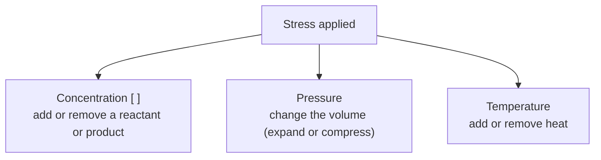

!!! objective "Students will be able to"
    State Le Chatelier's Principle and then be able to predict the direction of a reaction based
    on the changes made to that reaction.

## Le Chatelier's Principle

**Le Chatelier's principle** states that when **stress** (a change) is added to a system
(reaction), the system moves in a direction to **minimize the stress** added.

Put another way: when something disturbs a system at equilibrium, the equilibrium shifts in the
direction that **counteracts** (works against) that change. This principle is very important in
AP Chem.

Le Chatelier's principle does not work for (adding or removing) solids/liquids.
{.star}

☆ Water ($\ce{H2O}$) is a pure liquid, so it is left out of K expressions!
{.boxed}

## Types of stress

There are three kinds of stress, one for each outside condition you can change:



All the examples use the synthesis of ammonia, $\ce{N2 + 3H2 <=> 2NH3}$ with
$\Delta H = -92\text{ kJ}$ (exothermic).

| Stress | Example | Shift | Why |
|---|---|---|---|
| 1. Change in **concentration** of a reactant or product | Add more $\ce{NH3}$ | Reverse reaction favored | It uses up the $\ce{NH3}$ that was added. |
| 2. Change in **pressure** | Decrease the volume of the container, so pressure increases | Forward reaction favored | It reduces the pressure: the left side has 4 mol of gas and the right side only 2 mol. |
| 3. Change in **heat / temperature** | Decrease the temperature | Forward reaction favored | Heat is released by the forward reaction. |

### 1. Change in concentration

Adding or removing a reactant or product pushes the reaction toward the side that uses it up (or
makes more of it).

| Stress | Shift | Why |
|---|---|---|
| Add a reactant | Forward | The forward reaction uses up (consumes) the added reactant. |
| Remove a reactant | Reverse | The reverse reaction makes more of it. |
| Add a product | Reverse | The reverse reaction uses up the added product. |
| Remove a product | Forward | The forward reaction makes more of it. |

!!! example "Example: adding more NH₃"
    $$\ce{N2 + 3H2 <=> 2NH3} \qquad \Delta H = -92\text{ kJ}$$

    - **Stress:** add more $\ce{NH3}$.
    - **Result:** the reverse reaction is favored, using up the $\ce{NH3}$ added.

!!! example "Example: increasing [N₂]"
    $$\ce{N2(g) + 3H2(g) <=> 2NH3(g)}$$

    - **Stress:** increase $[\ce{N2}]$.
    - **Result:** the **forward reaction is favored**, because it consumes $\ce{N2}$.

!!! example "Example: removing NH₃"
    $$\ce{N2(g) + 3H2(g) <=> 2NH3(g)}$$

    - **Stress:** decrease $[\ce{NH3}]$ (remove $\ce{NH3}$).
    - **Result:** the system has to make more $\ce{NH3}$. The forward reaction is the one that
      makes $\ce{NH3}$, so the **forward reaction is favored**.

The graph shows all three concentrations when $\ce{N2}$ is added to the equilibrium mixture.
Only the species that was added jumps; the others change smoothly as the reaction shifts.

```graph
x: {label: t}
y: {label: Concentration, min: 0, max: 0.8}
curves:
  - {points: [[0, .35], [4, .35]], smooth: false, label_at: none, color: 1}
  - {points: [[4, .35], [4, .70]], smooth: false, label_at: none, color: 1}
  - {points: [[4, .70], [5, .665], [6.5, .652], [10, .65]], label: "[N2]", label_at: end, color: 1}
  - {points: [[0, .60], [4, .60], [5, .495], [6.5, .456], [10, .45]], label: "[H2]", label_at: end, color: 2}
  - {points: [[0, .20], [4, .20], [5, .27], [6.5, .296], [10, .30]], label: "[NH3]", label_at: end, color: 3}
annotations:
  - vline: 4
    text: "N2 added"
caption: "Adding N₂: [N₂] jumps up, then falls as the forward reaction uses it; [H₂] falls and [NH₃] rises until a new equilibrium."
```

### 2. Change in pressure

Pressure can be changed by changing the volume of the gas (or by changing the # of moles of gas
in the container):

- **Increasing the volume** of the gas makes the pressure go down.
- **Decreasing the volume** of the gas makes the pressure go up.

The piston picture shows why. Pulling the piston up from its initial position to its final
position gives the same gas more room, so it pushes on the walls less: the pressure drops.

```graph
size: [290, 230]
axes: none
x: {min: 0, max: 12.8}
y: {min: 0, max: 10}
curves:
  - {points: [[2, 9.2], [2, 0.5], [6, 0.5], [6, 9.2]], smooth: false, color: ink, label_at: none}
  - {points: [[2, 3.5], [6, 3.5]], smooth: false, color: 1, label_at: none}
  - {points: [[4, 3.5], [4, 10]], smooth: false, color: 1, label_at: none}
  - {points: [[2, 6.5], [6, 6.5]], smooth: false, color: 2, style: dashed, label_at: none}
annotations:
  - arrow: {from: [3, 3.9], to: [3, 6.1]}
  - text: initial position
    at: [6.3, 3.3]
    anchor: start
  - text: final position
    at: [6.3, 6.3]
    anchor: start
  - arrow: {from: [1.3, 0.6], to: [1.3, 3.4], heads: both}
  - text: "V_{initial}"
    at: [1.0, 1.8]
    anchor: end
  - arrow: {from: [10.9, 0.6], to: [10.9, 6.4], heads: both}
  - text: "V_{final}"
    at: [11.2, 3.3]
    anchor: start
  - point: [2.8, 1.3]
  - point: [4.7, 1.0]
  - point: [3.7, 2.4]
  - point: [5.3, 2.7]
caption: "Inc in volume = Dec in pressure · Dec in volume = Inc in pressure"
```

Look for the # of moles of gas in a balanced reaction to determine the direction of the rxn.
{.star}

The side with **more moles of gas** is the **high-pressure** side, and the side with fewer moles
of gas is the **low-pressure** side. The reaction shifts toward whichever side undoes the change:

| Stress | Pressure | Shift toward | Ammonia ($4 \text{ mol} \rightleftharpoons 2 \text{ mol}$) |
|---|---|---|---|
| Decrease the volume | Goes up | Fewer moles of gas (lowers P) | Forward |
| Increase the volume | Goes down | More moles of gas (raises P) | Reverse |

!!! example "Example: shrinking the container"
    $$\ce{N2 + 3H2 <=> 2NH3} \qquad \Delta H = -92\text{ kJ}$$

    - **Stress:** the volume of the container decreases, so the pressure increases.
    - **Outcome:** P is increased.
    - **Count the moles of gas:** LHS $= 1 + 3 = 4$ mol, RHS $= 2$ mol.
    - **Result:** the direction favored when pressure is increased is **forward**, to the side
      with fewer moles of gas, to reduce pressure.

!!! example "Example: expanding the container"
    $$\underbrace{\ce{1N2(g) + 3H2(g)}}_{\text{LHS: } 1 + 3 = 4 \text{ mol (high pressure)}} \rightleftharpoons \underbrace{\ce{2NH3(g)}}_{\text{RHS: } 2 \text{ mol (low pressure)}}$$

    - **Stress:** increase the volume, so the pressure decreases.
    - **Outcome:** the system does the opposite and works to increase the pressure.
    - **Result:** the **reverse reaction is favored**, toward the 4 mol (high-pressure) side.

If both sides have the **same moles of gas**, like $\ce{H2(g) + I2(g) <=> 2HI(g)}$ (2 mol on
each side), changing the volume does not shift the equilibrium.
{.star}

### 3. Heat / temperature

To use Le Chatelier with temperature, treat heat like a reactant or product. An **endothermic**
reaction absorbs heat, so heat goes on the reactant side. An **exothermic** reaction releases
heat, so heat goes on the product side.

!!! formula "Endothermic vs exothermic reactions"
    | | Endothermic reaction | Exothermic reaction |
    |---|---|---|
    | Heat | Reactants absorb heat ($\Delta H = +$) | Reaction releases heat ($\Delta H = -$) |
    | Heat as a term (**preferred format**) | $A + B + (\#\text{kJ}) \rightleftharpoons C + D$ | $A + B \rightleftharpoons C + D + (\#\text{kJ})$ |
    | Written with $\Delta H$ | $A + B \rightleftharpoons C + D \quad \Delta H = +\#\text{kJ}$ | $A + B \rightleftharpoons C + D \quad \Delta H = -\#\text{kJ}$ |

!!! example "Example: lowering the temperature"
    Rewrite the reaction with heat as a term. $\Delta H$ is negative, so heat is a product:

    $$\ce{N2 + 3H2 <=> 2NH3} \qquad \Delta H = -92\text{ kJ}$$

    $$\ce{N2 + 3H2 <=> 2NH3} + 92\text{ kJ}$$

    - **Stress:** decrease the temperature.
    - **Result:** the forward reaction is favored because heat is released.

Cooling favors the direction that releases heat (the exothermic direction).
{.star}

!!! example "Example: raising the temperature"
    $$\ce{N2(g) + 3H2(g) <=> 2NH3(g)} + 92\text{ kJ}$$

    - **Stress:** increase the heat (raise the temperature).
    - **Outcome:** heat is a product, so the **reverse reaction is favored** to use up the added
      heat and cool the system down.

Heating favors the direction that absorbs heat (the endothermic direction).
{.star}

A temperature change has no "jump" on a concentration graph: nothing is added or removed, the
reaction just shifts. Here the reverse reaction uses up $\ce{NH3}$ and makes $\ce{N2}$ and
$\ce{H2}$.

```graph
x: {label: t}
y: {label: Concentration, min: 0, max: 0.8}
curves:
  - {points: [[0, .60], [4, .60], [5, .65], [6.5, .67], [10, .675]], label: "[H2]", label_at: end, color: 2}
  - {points: [[0, .35], [4, .35], [5, .367], [6.5, .373], [10, .375]], label: "[N2]", label_at: end, color: 1}
  - {points: [[0, .20], [4, .20], [5, .167], [6.5, .153], [10, .15]], label: "[NH3]", label_at: end, color: 3}
annotations:
  - vline: 4
    text: "temperature raised"
caption: "Raising the temperature of the exothermic ammonia synthesis: [NH₃] falls while [N₂] and [H₂] rise."
```

### Temperature is the only stress that changes K

Concentration and pressure stresses change Q, and the reaction shifts back to the **same** K. A
temperature change is different: it changes the **value of K** itself (see
[Q explains Le Chatelier](reaction-quotient.md#q-explains-le-chatelier)).

| Reaction | Raise the temperature | Lower the temperature |
|---|---|---|
| Exothermic (heat is a product) | Reverse favored, **K decreases** | Forward favored, **K increases** |
| Endothermic (heat is a reactant) | Forward favored, **K increases** | Reverse favored, **K decreases** |

## What does not shift an equilibrium

Some changes look like stresses but do not move the equilibrium at all.

| Change | Why there is no shift |
|---|---|
| Adding or removing a **solid or liquid** | Its activity is always 1, so it is not part of K or Q. |
| Adding a **catalyst** | It speeds up the forward and reverse reactions equally: equilibrium is reached faster, but at the same place. |
| Adding an **inert gas** (one not in the reaction, like Ar) at constant volume | The total pressure goes up, but the concentrations (partial pressures) of the reacting gases don't change. |
| Changing the volume when **both sides have the same moles of gas** | Neither direction can raise or lower the pressure. |

## Summary: the ammonia synthesis

Every stress on one reaction, written with heat as a term:

$$\ce{N2(g) + 3H2(g) <=> 2NH3(g)} + 92\text{ kJ}$$

| Stress | Shift | Value of K |
|---|---|---|
| Add $\ce{N2}$ or $\ce{H2}$ | Forward | Same |
| Remove $\ce{NH3}$ | Forward | Same |
| Add $\ce{NH3}$ | Reverse | Same |
| Decrease the volume (pressure up) | Forward (toward 2 mol of gas) | Same |
| Increase the volume (pressure down) | Reverse (toward 4 mol of gas) | Same |
| Raise the temperature | Reverse | Decreases |
| Lower the temperature | Forward | Increases |
| Add a catalyst | No shift (equilibrium is reached faster) | Same |

End of concentration
{.divider}
