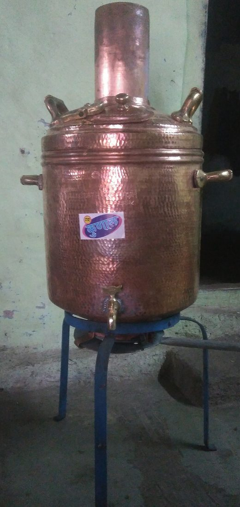

## How to measure heat (q)

Heat ($q$) is measured with **calorimetry**, using a **calorimeter**.

**Calorimetry**
:   The process in which the heat of a reaction ($q_{rxn}$) can be calculated or measured.

**Calorimeter**
:   The device used to measure it.

## Two types of calorimeter

There are two types of calorimeter, a light one and a heavy one:

<div class="cols" markdown>
<div markdown>
A **coffee cup calorimeter** is made of **styrofoam** and is **lightweight**.

```apparatus
parts:
  - {type: coffee-cup, id: cc, fill: 0.55}
labels:
  - {text: Styrofoam, to: cc.cup, side: right}
caption: Coffee cup calorimeter
```

</div>
<div markdown>
A **bomb calorimeter** is made of **metal** and is **heavy**. It may or may not contain water.

```apparatus
parts:
  - {type: bomb-calorimeter, id: b}
labels:
  - {text: Metal, to: b.bomb, side: left}
  - {text: Water, to: b.water, side: right}
caption: Bomb calorimeter
```

</div>
</div>

## Heat capacity (C) vs. specific heat (c)

Uppercase $C$ and lowercase $c$ mean different things, so the case matters:

!!! formula "C (upper) vs c (lower)"
    | Symbol | Name | Of a… | Units |
    |---|---|---|---|
    | $C$ (upper) | **Heat capacity** | calorimeter | $\dfrac{J}{{}^{\circ}C}$ |
    | $c$ (lower) | **Specific heat** | substance | $\dfrac{J}{g\cdot {}^{\circ}C}$ |

**Heat capacity** ($C$)
:   The amount of heat ($q$) required to increase the temperature by **1 °C**.
    Units: $\dfrac{J}{{}^{\circ}C}$.

**Molar heat capacity** (of a substance)
:   Heat capacity with respect to **one mole**.

## Equations used to measure the heat of a reaction

These equations connect the heat ($q$) to the temperature change ($\Delta t$).

### Basic equations

All the $q$ values add up to zero:

!!! formula "Calorimetry energy balance"
    $$
    \begin{aligned}
    q_{system} + q_{surroundings} &= 0\\
    q_{reaction} + q_{calorimeter} &= 0
    \end{aligned}
    $$

### Formulas to calculate q

The heat is proportional to the temperature change, $q \propto \Delta t$. With the heat capacity
(uppercase $C$):

!!! formula "Heat from heat capacity (q = CΔt)"
    $$q_{calorimeter} = C\Delta t \qquad \text{(uppercase } C\text{)}$$

The heat is also proportional to the mass, $q \propto m\cdot\Delta t$. With the specific heat
(lowercase $c$):

!!! formula "Heat from specific heat (q = mcΔt)"
    $$q_{solution} = mc\cdot\Delta t \qquad \text{(lowercase } c\text{)}$$

In both, $\Delta t$ is the change in temperature, always final minus initial:

!!! formula "Temperature change (Δt)"
    $$\Delta t = t_{final} - t_{initial}$$

### Overall equation to calculate the heat of reaction

Putting both together gives the heat of reaction ($q_{rxn}$):

!!! formula "Heat of reaction (calorimeter + solution)"
    $$
    \begin{aligned}
    q_{rxn} + C\Delta t + mc\Delta t &= 0\\
    q_{rxn} + q_{calorimeter} + q_{solution} &= 0\\
    q_{rxn} &= -(C\Delta t + mc\Delta t)
    \end{aligned}
    $$

## Dissolution reaction

In a **dissolution reaction**, an ionic compound (salt) dissolves in water:
Ionic Compound (salt) + $\ce{H2O}$. In the $mc\Delta t$ term, both the salt and the water count:

!!! formula "Dissolution: m and c in mcΔt"
    $$
    \begin{aligned}
    m &= \text{mass}_{salt} + \text{mass}_{water}\\
    c &= \text{specific heat of water}
    \end{aligned}
    $$

## Combustion reaction

In a **combustion reaction**, a hydrocarbon burns in oxygen, and the heat of reaction is the
heat of combustion:

!!! formula "Combustion reaction heat"
    $$
    \begin{gathered}
    q_{reaction} = q_{combustion}\\
    \ce{C_{x}H_{y} + O2 -> CO2 + H2O}
    \end{gathered}
    $$

## Heat flow calorimetry

!!! objective "Students will be able to"
    - Use the calorimetry equation to solve for the unknown in a given FRQ.
    - Explain heat flow calorimetry (definition and an example problem).
    - Define enthalpy ($H$) and the methods of calculating $\Delta H^{\circ}_{rxn}$ (see [Enthalpy](enthalpy.md)).

In **heat flow calorimetry**, a hot object is put into cooler water. Heat flows from the hot object
into the water until **the temperature evens out**: both end at the same final temperature.

<div class="cols" markdown>
<div markdown>

```apparatus
parts:
  - {type: rod, id: rod, hot: true}
  - {type: beaker, id: bucket, style: cup, fill: 0.55, liquid: blue}
labels:
  - {text: "Hot metal rod\nt_{initial} = 95 °C", to: rod.bottom, side: bottom}
  - {text: "Bucket of water\nt_{initial} = 25 °C", to: bucket.bottom, side: bottom}
caption: Before
```

</div>
<div markdown>

```apparatus
parts:
  - {type: beaker, id: bucket, style: cup, fill: 0.62, liquid: blue, at: [0, 0]}
  - {type: rod, id: rod, height: 150, at: [6, -8]}
labels:
  - {text: "The rod in the water bucket\nt = 45 °C", to: bucket.bottom, side: bottom}
  - {text: "The temp\nevens out", to: bucket.liquid, side: right, arrow: true}
caption: After
```

</div>
</div>

No heat is lost: the heat the metal gives off is the heat the water takes in, so the two $q$
values add up to zero.

!!! formula "Heat flow: metal + water"
    $$
    \begin{aligned}
    q_{metal} &= m_{metal}\cdot c_{metal}\cdot\Delta t_{metal}\\
    q_{water} &= m_{water}\cdot c_{water}\cdot\Delta t_{water}\\
    q_{metal} + q_{water} &= 0
    \end{aligned}
    $$

<div class="admonition example" markdown>
<p class="admonition-title">Example: Specific heat of a metal</p>

A calorimeter contains **125 g of water** and its initial temperature is **21 °C**. A **35.0 g metal
sample** is heated to **99.8 °C** and dropped into the calorimeter. The final temperature of the
water and the metal is **23.1 °C**. Calculate the **specific heat of the metal**.

Make sure to write the decode column! {.star}

<div class="cols sidebar" markdown>
<div markdown>

Start from the heat flow equation and write out each $q$:

$$q_{metal} + q_{\ce{H2O}} = 0$$

$$[m_{metal}\cdot c_{metal}\cdot\Delta t_{metal}] + [m_{\ce{H2O}}\cdot c_{\ce{H2O}}\cdot\Delta t_{\ce{H2O}}] = 0$$

Substitute the values from the decode column:

$$[35.0\ \text{g}\cdot c_{metal}\cdot -76.7\ {}^{\circ}C] + [125\ \text{g}\cdot 4.184\ \tfrac{J}{g\cdot{}^{\circ}C}\cdot 2.1\ {}^{\circ}C] = 0$$

Solve for $c_{metal}$:

$$c_{metal} = \frac{125\ \text{g}\cdot 4.184\ \tfrac{J}{g\cdot{}^{\circ}C}\cdot 2.1\ {}^{\circ}C}{35.0\ \text{g}\cdot 76.7\ {}^{\circ}C} = \frac{1098\ \text{J}}{2685\ \text{g}\cdot{}^{\circ}C}$$

$$\therefore\ \boxed{c_{metal} = 0.409\ \tfrac{J}{g\cdot{}^{\circ}C}}$$

</div>
<div markdown>

**Decode FRQ**

$\ce{H2O}$
:   $m_{\ce{H2O}} = 125\ \text{g}$
:   $t_{initial} = 21.0\ {}^{\circ}C$
:   $c_{\ce{H2O}} = 4.184\ \tfrac{J}{g\cdot{}^{\circ}C}$

Metal
:   $m_{metal} = 35.0\ \text{g}$
:   $t_{initial} = 99.8\ {}^{\circ}C$
:   $c_{metal} = \,?$

$\ce{H2O}$ & metal
:   $t_{final} = 23.1\ {}^{\circ}C$
:   $\Delta t_{\ce{H2O}} = 23.1 - 21.0 = 2.1\ {}^{\circ}C$
:   $\Delta t_{metal} = 23.1 - 99.8 = -76.7\ {}^{\circ}C$

</div>
</div>

The metal **cools** ($\Delta t$ is negative, so $q_{metal} < 0$) and the water **warms**
($q_{\ce{H2O}} > 0$). The specific heat of water comes from the
[water facts](thermochemistry-basics.md#water-facts-specific-heat); how to fold the paper for the
decode column is in [Study Skills](../../study-skills.md#how-to-process-an-frq).

</div>

!!! note "Cultural note"
    { .note-photo loading=lazy }

    In India, when a girl gets married in an arranged marriage, her parents give her money and
    household necessities such as furniture. One item commonly given is a **copper water heater**:
    coal and kerosene are burned in it to heat the water.

    <small>Photo: a copper water heater (*bamb*) by [Rohini Bhagat](https://commons.wikimedia.org/wiki/File:%E0%A4%AC%E0%A4%82%E0%A4%AC.jpg),
    [CC BY-SA 4.0](https://creativecommons.org/licenses/by-sa/4.0/), via Wikimedia Commons (resized).</small>
